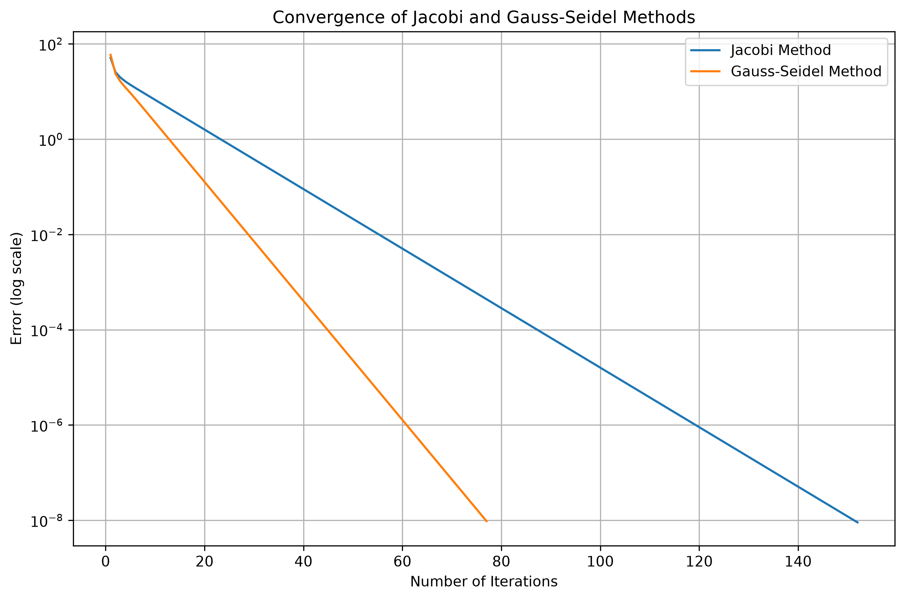

# TASK 8: ITERATIVE METHODS FOR LINEAR SYSTEMS

## 1. Introduction

Iterative methods are numerical techniques used to solve systems of linear equations. Instead of calculating the solution directly, they begin with an initial estimate and repeatedly improve it until the result is sufficiently accurate.

This task implements two iterative methods: Jacobi and Gauss-Seidel. Their performance is compared using a heat transfer problem.

## 2. Input Values and Mathematical Operations

The original system uses the following coefficient matrix:

A =
[[2, -1, 0, 0, 0],
 [-1, 2, -1, 0, 0],
 [0, -1, 2, -1, 0],
 [0, 0, -1, 2, -1],
 [0, 0, 0, -1, 2]]

The boundary temperature values are:

b = [100, 0, 0, 0, 20]

The program uses:
- Jacobi iteration.
- Gauss-Seidel iteration.
- Error calculation to determine convergence.
- NumPy direct solution for comparison.

The stopping tolerance is 0.00000001, with a maximum of 500 iterations.

## 3. Original Results

The Jacobi method produced the following temperature estimates:

[86.6667, 73.3333, 60.0000, 46.6667, 33.3333]

It converged after 152 iterations.

The Gauss-Seidel method produced:

[86.6667, 73.3333, 60.0000, 46.6667, 33.3333]

It converged after 77 iterations.

The direct solution obtained using NumPy was:

[86.6667, 73.3333, 60.0000, 46.6667, 33.3333]

Both iterative methods produced results very close to the direct solution.

## 4. Changing an Input Parameter

The left boundary temperature was changed from 100 to 120 while keeping the right boundary temperature at 20.

The new boundary values became:

b = [120, 0, 0, 0, 20]

The new Jacobi solution was:

[103.3333, 86.6667, 70.0000, 53.3333, 36.6667]

The method converged after 153 iterations.

The increase in the boundary temperature caused the estimated internal temperatures to increase as well.

## 5. Real-World Application

The methods were applied to a building temperature model. The model assumes that heat moves through five connected internal positions between two boundaries.

The boundary temperatures were set to 80 and 10 degrees Celsius.

The Gauss-Seidel method produced the following estimated internal temperatures:

[68.3333, 56.6667, 45.0000, 33.3333, 21.6667]

The method converged after 76 iterations.

This demonstrates how iterative numerical methods can be used to estimate temperature distribution within buildings.

## 6. Convergence Graph

The graph below compares how quickly the Jacobi and Gauss-Seidel methods approach the final solution.

The horizontal axis represents the number of iterations, while the vertical axis represents the error on a logarithmic scale.

The graph shows that both methods reduce the error as the iterations increase. However, Gauss-Seidel converges faster because it uses updated values immediately during each iteration.

## 7. Conclusion

The task successfully demonstrated how Jacobi and Gauss-Seidel methods solve systems of linear equations through repeated calculations.

Both methods produced accurate results, but Gauss-Seidel required fewer iterations. Changing the boundary temperature also affected the estimated internal temperatures.

The exercise showed that iterative methods are useful when solving larger systems of equations, particularly in engineering applications such as heat transfer analysis.