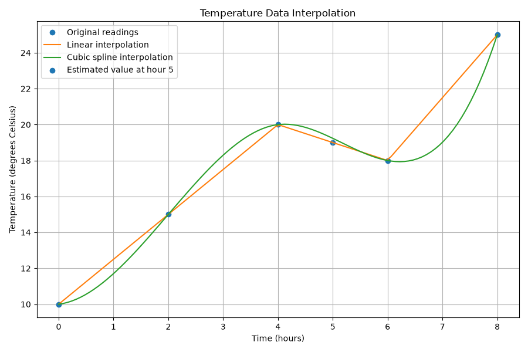

# Task 13: Interpolation

## 1. Mathematical Concept

Interpolation is a numerical technique used to estimate unknown values that fall between known data points.

It is useful when measurements have been collected at specific intervals but information is needed for a point between those measurements.

Two methods were used in this task:

**Linear Interpolation**

This method estimates an unknown value by assuming a straight-line relationship between two neighbouring data points.

**Cubic Spline Interpolation**

This method uses smooth cubic polynomial curves between data points to estimate unknown values.

Python's SciPy library provides interpolation functions that make it easier to perform these calculations.

## 2. Original Input Values and Operation

The program used temperature readings collected at different hours.

| Time (Hours) | Temperature (°C) |
|---|---:|
| 0 | 10 |
| 2 | 15 |
| 4 | 20 |
| 6 | 18 |
| 8 | 25 |

The objective was to estimate the temperature at hour 5.

The results were:

- Linear interpolation: 19.0°C
- Cubic spline interpolation: 19.234375°C

The two methods produced slightly different estimates because they use different approaches to calculate values between known measurements.

## 3. Changing an Input Value

The temperature reading at hour 6 was changed from 18°C to 22°C.

The new temperature readings became:

[10, 15, 20, 22, 25]

After performing linear interpolation again, the estimated temperature at hour 5 became 21.0°C.

The original estimate was 19.0°C.

This shows that changing an existing measurement can affect the estimated values between data points.

## 4. Real-World Application: Estimating Missing Rainfall Data

The program was modified to demonstrate how interpolation can be used to estimate missing rainfall measurements.

The recorded rainfall data was:

| Day | Rainfall (mm) |
|---|---:|
| 1 | 12 |
| 2 | 18 |
| 3 | 24 |
| 4 | 30 |
| 5 | 36 |

The objective was to estimate rainfall on day 2.5.

Using linear interpolation, the estimated rainfall was:

**21.0 mm**

This approach can help estimate missing measurements when rainfall data is collected at regular intervals.

## 5. Interpolation Graph

The program generated a graph showing the original temperature readings, the linear interpolation curve and the cubic spline interpolation curve.

The graph also shows the estimated temperature at hour 5.

The graph helps demonstrate how both methods estimate values between recorded measurements. The cubic spline produces a smoother curve, while linear interpolation connects neighbouring points using straight lines.

## 6. Conclusion

The task demonstrated how interpolation can be used to estimate missing values from existing data. Linear and cubic spline interpolation produced slightly different temperature estimates. Changing one of the recorded measurements also affected the estimated result. The rainfall example showed how interpolation can be applied in weather monitoring and other situations where some measurements are missing.