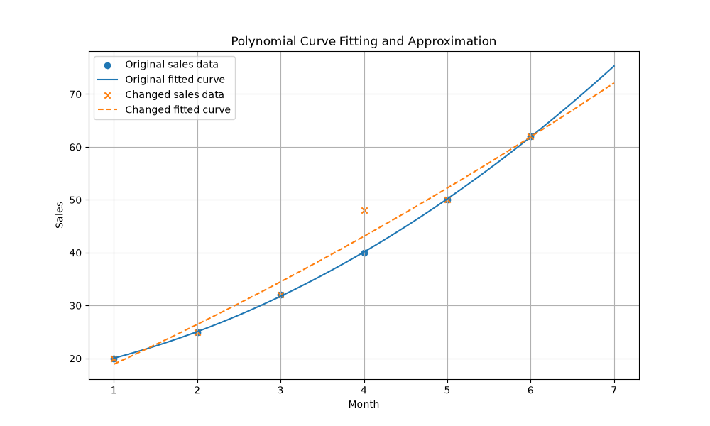

# TASK 14: CURVE FITTING AND APPROXIMATION

## 1. Mathematical Concept

Curve fitting is a numerical method used to find a mathematical function that best represents a set of data points. It helps identify patterns and estimate values that have not been directly measured.

In this task, polynomial curve fitting was performed using NumPy's `polyfit()` function. A second-degree polynomial was used to represent the relationship between the input and output values.

## 2. Original Input Values

The program used six months of sales data.

- Months: 1, 2, 3, 4, 5, 6
- Sales: 20, 25, 32, 40, 50, 62

The program fitted a quadratic polynomial to these values.

The resulting equation was approximately:

y = 0.8393x² + 2.496x + 16.7

The R-squared value was 0.9999, showing that the fitted curve closely represents the original sales data.

## 3. Changing an Input Value

The sales value for month 4 was changed from 40 to 48.

The original fitted prediction for month 4 was 40.11, while the new prediction was 43.09.

This demonstrates that changing an input value affects the fitted polynomial and its predictions.

## 4. Real-World Application

Curve fitting was applied to electricity consumption in a small business.

The recorded monthly consumption values were:

120, 135, 155, 180, 210 and 245 units.

A quadratic polynomial was fitted to the data to estimate future consumption.

The predicted electricity consumption for month 7 was 285 units.

This type of prediction can help a business estimate future electricity requirements and plan its expenses.

## 5. Output Interpretation

The results show that polynomial curve fitting can represent patterns in recorded data and estimate future values.

The high R-squared value indicates a close fit between the original sales data and the fitted curve. Changing one sales observation also changed the fitted equation and prediction.

The electricity example demonstrates how the same method can be applied to practical situations.

## 6. Conclusion

The task demonstrated how polynomial curve fitting and approximation can be performed using Python and NumPy. It also showed how changing input data affects the fitted curve and how the method can be used to estimate future values in real-world situations.

## 7. Graph

