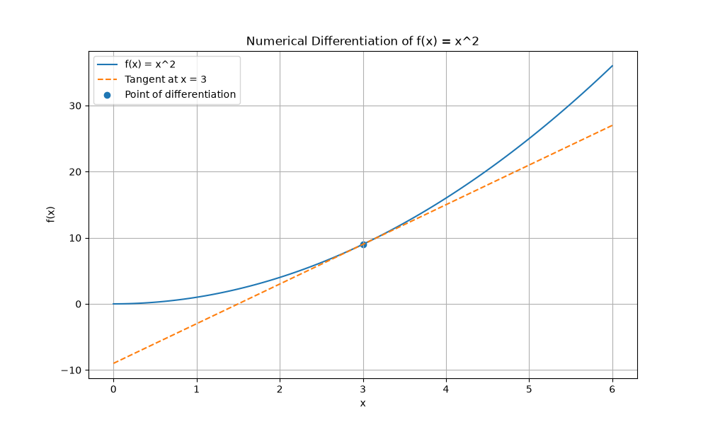

# TASK 15: NUMERICAL DIFFERENTIATION

## 1. Mathematical Concept

Numerical differentiation is a method used to estimate the derivative of a function using numerical values. It helps determine how quickly a quantity changes at a particular point.

Three methods were implemented:

- Forward difference
- Backward difference
- Central difference

## 2. Original Input Values

The function used was:

f(x) = x²

The derivative was calculated at x = 3 using a step size of 0.01.

The results were:

- Forward difference: 6.01
- Backward difference: 5.99
- Central difference: 6.00
- Exact derivative: 6.00

The central difference produced the same result as the exact derivative in this example.

## 3. Changing an Input Parameter

The step size was changed from 0.01 to 0.1.

The original central difference was 6.0, while the new central difference was also 6.0.

This happened because the central difference formula gives an exact result for this quadratic function when evaluated symmetrically.

## 4. Real-World Application

Numerical differentiation was applied to calculate the speed of a moving vehicle.

The distance function was:

s(t) = 5t² + 10t

The speed was estimated at 4 seconds.

The results were:

- Estimated speed: 50 m/s
- Exact speed: 50 m/s

The results show that numerical differentiation can be used to estimate the instantaneous speed of a moving vehicle from its distance function.

## 5. Output Interpretation

The program demonstrated that numerical differentiation can estimate the rate of change of a function.

The central difference method gave an accurate result in the original example. The vehicle application also produced an estimated speed that matched the exact value.

## 6. Conclusion

The task demonstrated how forward, backward and central difference methods can be implemented using Python. It also showed how numerical differentiation can be applied in real-world situations, such as calculating the speed of a moving vehicle.

## 7. Graph

