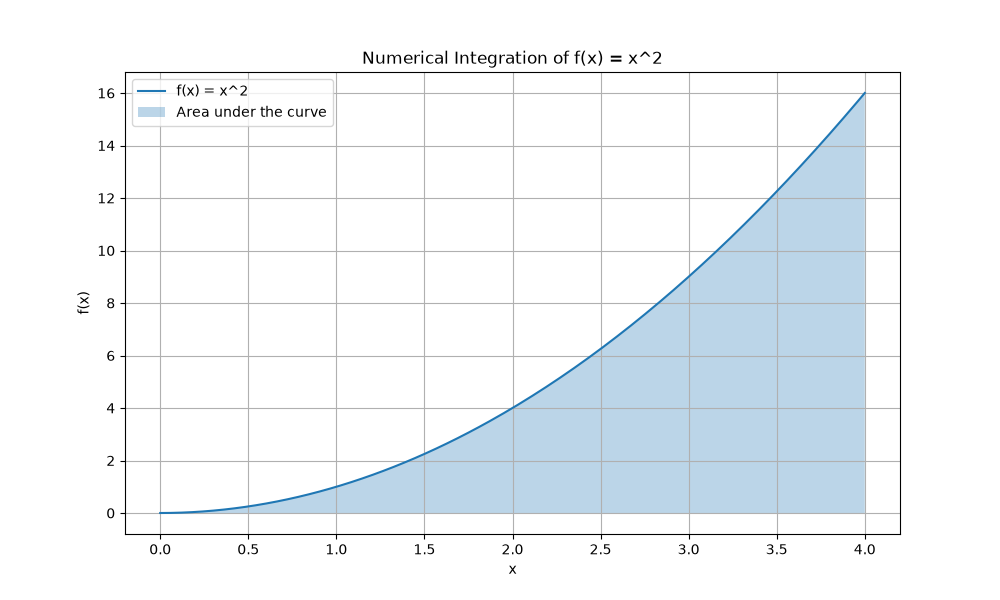

# TASK 16: NUMERICAL INTEGRATION

## 1. Mathematical Concept

Numerical integration is a mathematical method used to estimate the area under a curve or calculate the total accumulated value of a changing quantity over a given interval.

In this task, three integration approaches were used:

- Trapezoidal rule
- Simpson's rule
- Exact integration using SciPy's quad function

## 2. Original Input Values

The function used was:

f(x) = x²

The integration limits were:

- Lower limit: 0
- Upper limit: 4
- Number of intervals: 100

The calculated results were:

- Trapezoidal rule: 21.3344
- Simpson's rule: 21.333333
- Exact integration: 21.333333

Simpson's rule produced the same result as exact integration, while the trapezoidal rule gave a very close approximation.

## 3. Changing an Input Parameter

The number of intervals was reduced from 100 to 10.

The new results were:

- Trapezoidal result: 21.44
- Simpson's result: 21.333333

The original trapezoidal result was 21.3344.

Reducing the number of intervals increased the approximation error of the trapezoidal rule. Simpson's rule remained accurate for this quadratic function.

## 4. Real-World Application

Numerical integration was applied to calculate the total amount of water entering a storage tank.

The flow rate was represented by:

Q(t) = 2t + 5

The calculation covered a period of 10 minutes, starting at minute 0.

The results were:

- Estimated total water: 150 litres
- Exact total water: 150 litres

This demonstrates how numerical integration can be used to calculate accumulated quantities when the rate of flow changes over time.

## 5. Output Interpretation

The results show that numerical integration can estimate accumulated values over a specified interval.

Simpson's rule was more accurate than the trapezoidal rule in the original example. Changing the number of intervals also demonstrated how the accuracy of numerical approximations can be affected by the selected parameters.

## 6. Conclusion

The task demonstrated how numerical integration can be implemented using Python and SciPy. It also showed how different integration methods compare and how numerical integration can be applied to practical problems such as calculating the total amount of water entering a tank.

## 7. Graph

