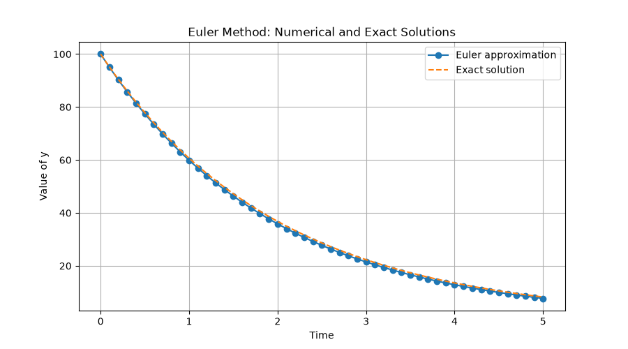

# TASK 17: ORDINARY DIFFERENTIAL EQUATIONS – EULER METHOD

## 1. Mathematical Concept

Euler's method is a numerical technique used to approximate solutions of ordinary differential equations (ODEs). It uses the current value and the derivative to estimate the next value.

The formula is:

y(n+1) = y(n) + h × f(t, y)

Where:
- y(n) is the current value.
- h is the step size.
- f(t, y) represents the differential equation.
- y(n+1) is the next estimated value.

## 2. Original Problem

The program solves the differential equation:

dy/dt = -0.5y

Initial value: 100

Time interval: 0 to 5

Step size: 0.1

The program uses Euler's method to estimate the solution and compares it with the exact mathematical solution.

## 3. Original Results

The program produced the following results:

- Final Euler approximation: 7.6945
- Final exact value: 8.2085
- Absolute error: 0.514

The results show that Euler's method provides an approximation that is close to the exact solution.

## 4. Changing an Input Parameter

The step size was changed from 0.1 to 0.5.

The new results were:

- New Euler approximation: 5.6314
- Exact value: 8.2085
- Absolute error: 2.5771

The error increased after using a larger step size. This shows that the accuracy of Euler's method is affected by the selected step size. Smaller steps generally produce more accurate results.

## 5. Modified Real-World Application: Medicine Concentration

Euler's method was modified to estimate how the concentration of medicine in the body decreases over time.

The assumptions were:
- Initial medicine concentration: 500 mg.
- Decay rate: 0.2 per hour.
- Time period: 5 hours.
- Step size: 0.5 hours.

The differential equation used was:

dC/dt = -0.2C

Where C represents the medicine concentration.

The program produced these results:

- Estimated concentration after 5 hours: 174.3392 mg.
- Exact concentration after 5 hours: 183.9397 mg.

The results demonstrate how Euler's method can estimate changes in medicine concentration over time.

## 6. Graph Interpretation

The graph compares the numerical solution obtained using Euler's method with the exact mathematical solution.

Both curves show the decreasing value over time. The Euler approximation follows the general pattern of the exact solution, although a small difference exists because the numerical method uses step-by-step estimates.

## 7. Conclusion

The task demonstrated how Euler's method can be used to approximate solutions of ordinary differential equations. Changing the step size showed that the accuracy of the method depends on the size of each step. The medicine concentration example also demonstrated how the method can be applied to a practical situation involving changes over time.