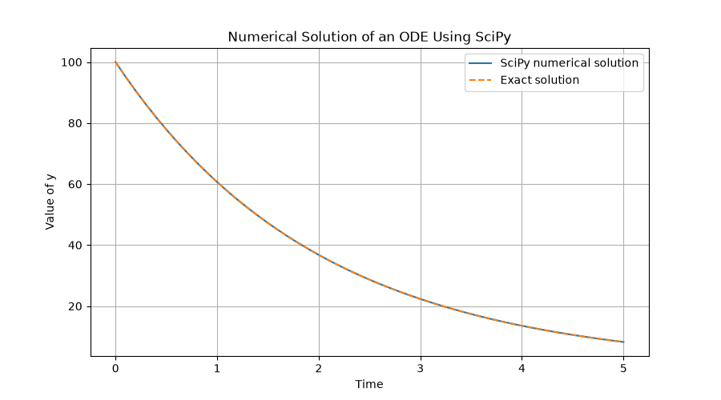

# TASK 18: NUMERICAL SOLUTION OF ODEs USING SCIPY

## 1. Mathematical Concept

SciPy is a Python library used for scientific and numerical computing. It provides functions for solving ordinary differential equations numerically.

In this task, the `solve_ivp()` function was used to approximate the solution of a differential equation over a specified time interval.

The function takes the differential equation, time interval, initial value and evaluation points as inputs.

## 2. Original Problem

The program solves the differential equation:

dy/dt = -0.5y

Initial value: 100

Time interval: 0 to 5

The `solve_ivp()` function was used to calculate the numerical solution. The result was then compared with the exact mathematical solution.

## 3. Original Results

The program produced the following results:

- Initial value: 100
- Final SciPy solution: 8.2173
- Final exact value: 8.2085
- Absolute error: 0.008766

The numerical result was very close to the exact solution, showing that SciPy can provide accurate approximations of differential equations.

## 4. Changing an Input Parameter

The initial value was changed from 100 to 150 while keeping the same differential equation and time interval.

The new results were:

- New initial value: 150
- Final SciPy solution: 12.3259
- New exact value: 12.3127

The final value increased because the starting value was increased. This demonstrates how changing an initial condition affects the solution of a differential equation.

## 5. Modified Real-World Application: Medicine Concentration

The program was modified to represent the decrease in medicine concentration over time.

The assumptions were:

- Initial medicine concentration: 500 mg.
- Decay rate: 0.2 per hour.
- Time period: 5 hours.

The differential equation used was:

dC/dt = -0.2C

Where C represents the medicine concentration.

The program produced the following results:

- Estimated concentration after 5 hours: 183.9568 mg.
- Exact concentration: 183.9397 mg.

The results show how numerical methods can be used to estimate the amount of medicine remaining over time.

## 6. Graph Interpretation

The graph compares the numerical solution obtained using SciPy with the exact mathematical solution.

Both curves show a decrease in the value over time. The two curves are very close to each other, indicating that the numerical solution is accurate.

## 7. Conclusion

The task demonstrated how SciPy can be used to solve ordinary differential equations numerically. Changing the initial value affected the final result, while the medicine concentration example showed a practical application of differential equations. The results also demonstrated that SciPy can provide accurate numerical approximations.