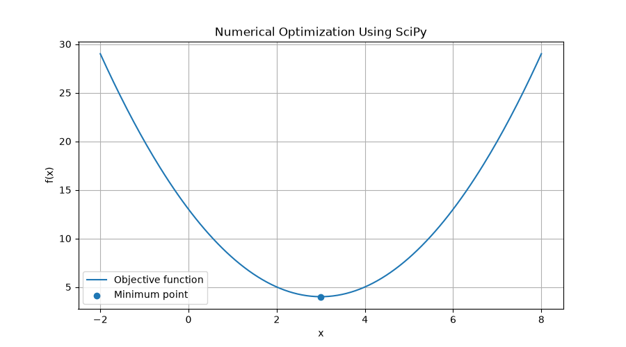

# TASK 19: NUMERICAL OPTIMIZATION

## 1. Mathematical Concept

Numerical optimization is a mathematical technique used to find the minimum or maximum value of a function.

In Python, the SciPy library provides optimization functions such as `minimize()` and `minimize_scalar()`.

These functions help find the best possible solution by evaluating different values of a function.

## 2. Original Problem

The original function used was:

f(x) = (x - 3)² + 4

The program used SciPy's `minimize()` function to find the minimum value of the function.

The initial guess was 0.

## 3. Original Results

The program produced the following results:

- Initial guess: 0
- Optimal value of x: 3.0
- Minimum function value: 4.0
- Optimization successful: True

The results show that the function reaches its minimum value of 4 when x equals 3.

## 4. Changing an Input Parameter

The initial guess was changed from 0 to 10.

The new results were:

- New initial guess: 10
- New optimal value of x: 3.0
- New minimum function value: 4.0

The result remained the same because the optimization algorithm successfully found the minimum point despite the change in the starting value.

## 5. Modified Real-World Application: Business Cost Minimization

The program was modified to represent a business trying to minimize its production costs.

The cost function used was:

Cost(x) = 2x² - 40x + 500

Where x represents the number of production batches.

The assumptions were:
- Production is considered within a range of 0 to 20 batches.
- The cost function represents the estimated production cost.
- The objective is to find the production quantity with the lowest cost.

The program produced the following results:

- Optimal production quantity: 10 batches.
- Minimum production cost: 300.
- Optimization successful: True.

This shows how numerical optimization can help a business identify a production level that minimizes its estimated costs.

## 6. Graph Interpretation

The graph shows the original objective function and its minimum point.

The curve reaches its lowest point at x = 3, where the function value is 4. This visually confirms the result obtained using SciPy.

## 7. Conclusion

The task demonstrated how numerical optimization can be performed using Python and SciPy. Changing the initial guess did not affect the final minimum in this example. The business cost application also showed how optimization can support decision-making by identifying the production quantity associated with the lowest estimated cost.