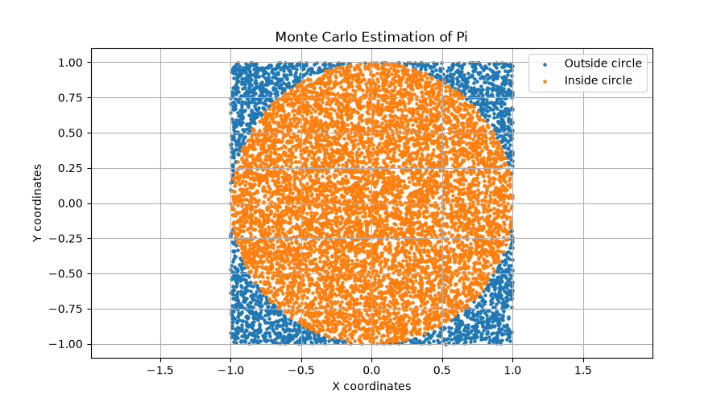

# TASK 20: RANDOM NUMBERS AND MONTE CARLO METHODS

## 1. Mathematical Concept

Random numbers are values generated without following a predictable sequence. In Python, NumPy provides functions for generating random numbers.

The Monte Carlo method uses random sampling to solve mathematical problems and estimate numerical results.

In this task, random points were generated within a square and used to estimate the value of π.

The estimation formula is:

π ≈ 4 × (Points inside the circle / Total points)

## 2. Generating Random Numbers

The program generated 10 random numbers using NumPy.

The results were:

- Mean: 0.5201
- Minimum: 0.0581
- Maximum: 0.9507

These results show that NumPy can generate random values within a specified range.

## 3. Monte Carlo Estimation of π

The program generated 10,000 random points within a square and checked how many fell inside a unit circle.

The results were:

- Total random points: 10,000
- Points inside the circle: 7,838
- Estimated value of π: 3.1352
- Actual value of π: 3.141593
- Absolute error: 0.006393

The estimated value was close to the actual value of π.

## 4. Changing an Input Parameter

The number of random points was increased from 10,000 to 100,000.

The new results were:

- Total random points: 100,000
- Points inside the circle: 78,524
- New estimated value of π: 3.14096
- Actual value of π: 3.141593
- New absolute error: 0.000633

The error decreased after increasing the number of random points. This demonstrates that using more random samples can improve the accuracy of Monte Carlo estimation.

## 5. Modified Real-World Application: Project Cost Estimation

The program was modified to simulate possible project costs using random values.

The assumptions were:

- Minimum estimated project cost: 80,000.
- Maximum estimated project cost: 120,000.
- Number of simulations: 10,000.

The program generated different possible project costs and calculated their average, minimum and maximum values.

The results were:

- Average estimated project cost: 99,673.48.
- Minimum simulated cost: 80,010.75.
- Maximum simulated cost: 119,999.59.
- Probability of cost exceeding 100,000: 49.09%.

The results demonstrate how Monte Carlo simulation can help estimate possible project costs and assess financial uncertainty.

## 6. Graph Interpretation

The graph displays randomly generated points inside and outside a unit circle.

The points inside the circle are used to estimate its area compared with the area of the surrounding square. This ratio is then used to approximate π.

## 7. Conclusion

The task demonstrated how random number generation and Monte Carlo methods can be implemented using Python. Increasing the number of random points improved the estimate of π. The project cost simulation also demonstrated how random sampling can be applied to real-world estimation and decision-making.